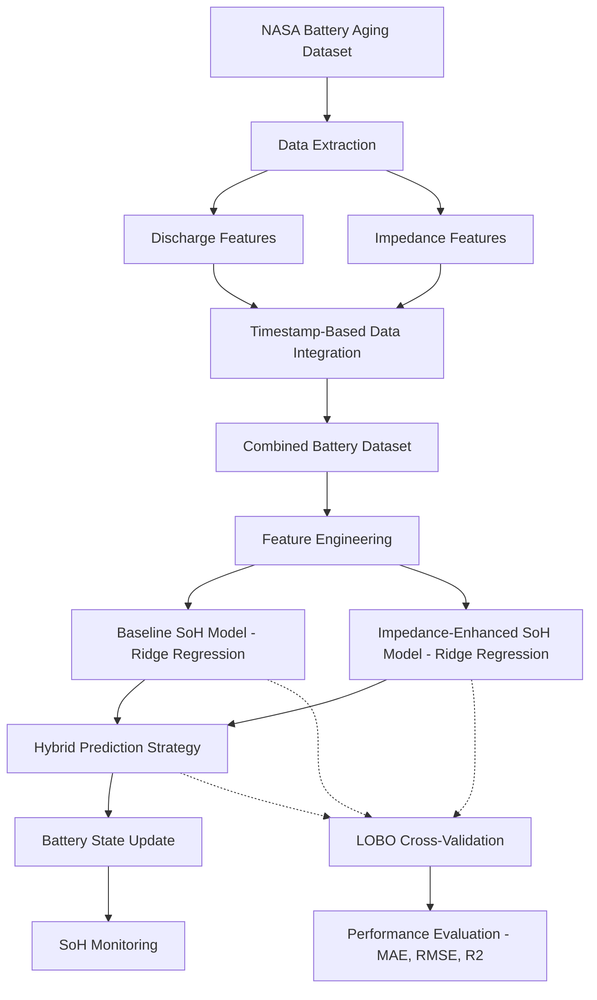

# Battery Digital Twin: Explainable State-of-Health Estimation

A data-driven **Digital Twin prototype for lithium-ion battery health monitoring**, combining operational measurements, electrochemical impedance indicators, and machine learning to estimate Battery State of Health (SoH).

The project investigates how measurable battery characteristics can support interpretable health estimation, how impedance information contributes to predictive performance, and how a hybrid modelling strategy can handle incomplete measurements.

---

## Project Overview

Lithium-ion batteries gradually lose capacity and performance through ageing. Reliable State-of-Health estimation is essential for battery monitoring, predictive maintenance, and Battery Management Systems (BMS).

This project develops a data-driven Digital Twin prototype using the **NASA Battery Aging Dataset**. It integrates discharge measurements and electrochemical impedance indicators into a unified dataset, applies machine learning models for SoH estimation, and represents battery health through an updatable digital state.

### Main Research Question

To what extent can operational measurements and impedance-derived indicators improve the accuracy and interpretability of State-of-Health estimation across different lithium-ion battery cells?

### Objectives

- Extract and integrate operational and impedance measurements from battery ageing experiments.
- Investigate relationships between battery degradation and measurable health indicators.
- Develop baseline and impedance-enhanced machine learning models for SoH estimation.
- Implement a hybrid prediction strategy to handle missing impedance measurements.
- Evaluate model generalisation to previously unseen battery cells.
- Develop a digital representation of battery health that can be updated using successive observations.

---

## Dataset

The project uses the **NASA Battery Aging Dataset**, which contains charge, discharge, and electrochemical impedance spectroscopy (EIS) measurements collected during lithium-ion battery ageing experiments.

Four battery cells are analysed:

| Battery | Discharge Observations | Impedance Observations |
|---|---:|---:|
| B0005 | 168 | 278 |
| B0006 | 168 | 278 |
| B0007 | 168 | 278 |
| B0018 | 132 | 53 |
| **Total** | **636** | **887** |

### Measurement Characteristics

- **Charging:** Constant-current charging at 1.5 A until 4.2 V, followed by constant-voltage charging until the current decreases to 20 mA.
- **Discharging:** Constant-current discharge at approximately 2 A, with battery-specific voltage cut-off limits.
- **Impedance:** Electrochemical impedance measurements over a frequency range of 0.1 Hz to 5 kHz.

The extracted impedance indicators include:

- \(R_e\): estimated electrolyte resistance.
- \(R_{ct}\): estimated charge-transfer resistance.

The project retains discharge observations with missing impedance measurements rather than removing them. Timestamp-based matching, using a one-hour tolerance, produces an integrated dataset containing **636 discharge observations**, of which **419 have matched impedance measurements**.

### Dataset Source

- [NASA Battery Data Set – PHM Society mirror](https://phm-datasets.s3.amazonaws.com/NASA/5.+Battery+Data+Set.zip)
- [NASA Prognostics Data Repository](https://www.nasa.gov/intelligent-systems-division/discovery-and-systems-health/pcoe/pcoe-data-set-repository/)
- [Dataset documentation and citation](data/README.md)

The original MATLAB files are not included in this repository.

---

## Digital Twin Architecture

The proposed architecture follows a data-driven Digital Twin workflow connecting experimental measurements, feature extraction, data integration, health estimation, and battery-state updates.

### System Workflow

1. **Data Acquisition:** The NASA dataset provides charge, discharge, and impedance measurements for four lithium-ion battery cells.
2. **Feature Extraction:** Discharge features include voltage, current, temperature, discharge capacity, and calculated SoH. Impedance features include \(R_e\) and \(R_{ct}\).
3. **Data Integration:** Discharge and impedance observations are associated through timestamp-based matching. An impedance measurement is considered available when it falls within the one-hour matching window.
4. **Feature Engineering:** Operational and impedance-derived features are prepared for model training and evaluation.
5. **Health Estimation:** A baseline Ridge Regression model and an impedance-enhanced model estimate battery SoH. A hybrid prediction strategy selects the impedance-enhanced prediction when impedance data are available and otherwise uses the baseline model.
6. **Digital Twin State Update:** Estimated SoH and available measurements are incorporated into a battery-state representation, enabling health monitoring across successive observations.
7. **Model Validation:** Leave-One-Battery-Out (LOBO) validation evaluates predictive performance and generalisation across unseen battery cells.

### Architecture Diagram



---

## Methodology

### 1. State of Health Estimation

Battery State of Health is calculated from the measured discharge capacity relative to the initial discharge capacity of the corresponding battery.

\[
SoH_i(\%) =
\frac{Q_i}{Q_{\mathrm{initial}}}\times 100
\]

Where:

- \(Q_i\) is the discharge capacity at observation \(i\), in Ah.
- \(Q_{\mathrm{initial}}\) is the initial discharge capacity of the battery.

Discharge capacity is calculated by integrating the absolute discharge current over time:

\[
Q_i =
\frac{1}{3600}
\sum_{k=1}^{n}
|I_k|\Delta t_k
\]

Where \(I_k\) is the measured current in amperes and \(\Delta t_k\) is the sampling interval in seconds.

### 2. Feature Extraction

The operational feature set includes:

- Mean, minimum, and maximum voltage.
- Mean discharge current.
- Mean and maximum temperature.
- Temperature rise during discharge.

The impedance-enhanced feature set additionally includes:

- Electrolyte resistance (\(R_e\)).
- Charge-transfer resistance (\(R_{ct}\)).

Discharge duration is excluded from the predictive feature set because it is directly involved in the calculation of discharge capacity and could introduce target leakage.

### 3. Machine Learning Models

Ridge Regression is used to estimate SoH.

**Baseline model:**

Uses operational measurements:

\[
\hat{SoH}_{A} = f(X_{\mathrm{operational}})
\]

**Impedance-enhanced model:**

Incorporates impedance-derived features:

\[
\hat{SoH}_{B} =
f(X_{\mathrm{operational}}, R_e, R_{ct})
\]

Feature standardisation is performed using `StandardScaler`, and Ridge Regression is applied with a regularisation parameter of \(\alpha=1\).

### 4. Hybrid Prediction Strategy

Impedance measurements are not available for every discharge observation. The hybrid approach uses the impedance-enhanced model when the required impedance features are available and the baseline model otherwise.

\[
\hat{SoH}_{\mathrm{hybrid},i} =
\begin{cases}
\hat{SoH}_{B,i}, & \text{if impedance is available}\\
\hat{SoH}_{A,i}, & \text{otherwise}
\end{cases}
\]

This strategy preserves observations with incomplete impedance information and avoids excluding them from health monitoring.

### 5. Relaxation-Derived Indicators

Post-discharge voltage relaxation is also investigated. The relaxation response is approximated using an exponential function:

\[
V(t)=V_{\infty}
+A\exp\left(-\frac{t-t_0}{\tau}\right)
\]

Where:

- \(V_{\infty}\) is the fitted asymptotic voltage.
- \(A\) is the fitted voltage relaxation amplitude.
- \(\tau\) is the relaxation time constant.
- \(t_0\) is the beginning of the relaxation interval.

An apparent resistance proxy is calculated using the fitted relaxation amplitude and the current immediately before discharge termination:

\[
R_{\mathrm{app}} =
\frac{A}{|I_{\mathrm{before\ cutoff}}|}
\]

This quantity is treated as an empirical diagnostic indicator, not as a validated ohmic resistance or an identified equivalent-circuit parameter.

---

## Model Validation

The models are evaluated using **Leave-One-Battery-Out (LOBO) cross-validation**.

In each experiment:

- Three batteries are used for training.
- The remaining battery is held out for testing.
- The process is repeated until every battery has been used as the test battery.

This validation strategy evaluates generalisation to a battery cell not included in the training data.

### Evaluation Metrics

**Mean Absolute Error (MAE)**

\[
MAE =
\frac{1}{n}\sum_{i=1}^{n}
|y_i-\hat{y}_i|
\]

**Root Mean Squared Error (RMSE)**

\[
RMSE =
\sqrt{
\frac{1}{n}\sum_{i=1}^{n}
(y_i-\hat{y}_i)^2
}
\]

**Coefficient of Determination**

\[
R^2 =
1-
\frac{\sum_{i=1}^{n}(y_i-\hat{y}_i)^2}
{\sum_{i=1}^{n}(y_i-\bar{y})^2}
\]

Where \(y_i\) is the measured SoH, \(\hat{y}_i\) is the estimated SoH, and \(\bar{y}\) is the mean measured SoH.

---

## Results

### 1. Baseline SoH Estimation

The baseline Ridge Regression model was evaluated using all available discharge observations.

| Held-out Battery | MAE (%) | RMSE (%) | \(R^2\) |
|---|---:|---:|---:|
| B0005 | 1.7923 | 2.5010 | 0.9402 |
| B0006 | 3.4296 | 4.2320 | 0.8825 |
| B0007 | 4.2123 | 4.9917 | 0.6540 |
| B0018 | 1.5000 | 1.7369 | 0.9564 |

The results show differences in predictive performance across battery cells, highlighting the challenge of generalising health estimation models across batteries with different degradation trajectories.

### 2. Impedance Contribution

A fair comparison was conducted using the same matched observations for both models.

The impedance-enhanced model achieved a weighted MAE of **2.0762%**, compared with **2.6949%** for the baseline model, corresponding to an overall reduction of approximately **22.96%**.

However, the contribution of impedance features varied across batteries. The impedance-enhanced model improved performance for B0006 and B0007 but did not improve it for B0005 and B0018.

This indicates that impedance-derived indicators can provide useful additional information, but their contribution is battery-dependent.

### 3. Hybrid Digital Twin Prediction

The hybrid strategy was evaluated against the baseline model using the same training observations and all available test observations.

| Held-out Battery | Baseline MAE (%) | Hybrid MAE (%) |
|---|---:|---:|
| B0005 | 2.0666 | 2.2762 |
| B0006 | 3.2443 | 3.1331 |
| B0007 | 4.5667 | 2.6991 |
| B0018 | 1.7862 | 2.0739 |
| **Weighted MAE** | **2.9799** | **2.5723** |

The hybrid strategy reduced the weighted MAE by approximately **13.68%** compared with the baseline approach.

The improvement was particularly evident for B0007, while performance decreased for B0005 and B0018. This confirms that the benefits of impedance-enhanced estimation are not uniform across battery cells.

### 4. Relaxation and Apparent Resistance Analysis

The post-discharge relaxation response was fitted for observations with sufficient data. The resulting parameters were investigated as additional degradation indicators.

Although several relaxation parameters and apparent resistance estimates showed correlations with SoH, adding them to the current cross-battery regression model did not improve overall LOBO predictive performance.

Consequently, these indicators are retained as diagnostic analyses rather than included in the main predictive model.

### Detailed Results

The complete experimental analysis, including residual statistics, model comparisons, relaxation analysis, resistance correlations, and additional visualisations, is available in:

- [Detailed Modelling Summary](results/modelling_summary.md)
- [Hybrid SoH Validation](results/hybrid_soh_validation.png)
- [Hybrid SoH Residual Analysis](results/hybrid_soh_residuals.png)
- [Impedance Contribution Analysis](results/impedance_contribution_analysis.csv)
- [Model A vs. Hybrid Comparison](results/model_A_vs_hybrid.csv)
- [Revised Apparent Resistance Analysis](results/revised_resistance_model_summary.csv)

---

## Repository Structure

```text
battery-digital-twin/
│
├── data/
│   └── README.md
│
├── notebooks/
│   ├── 01_Battery_Digital_Twin_Data_Exploration_and_Modelling.ipynb
│   ├── 02_Battery_Digital_Twin_Architecture.ipynb
│   └── README.md
│
├── results/
│   ├── README.md
│   ├── modelling_summary.md
│   ├── model_A_vs_hybrid.csv
│   ├── impedance_contribution_analysis.csv
│   ├── residual_statistics.csv
│   ├── revised_resistance_model_summary.csv
│   ├── hybrid_soh_validation.png
│   ├── hybrid_soh_residuals.png
│   └── revised_resistance_vs_soh.png
│
├── .gitignore
└── README.md
```

Original MATLAB files and other generated intermediate files are excluded from version control where specified in `.gitignore`.

---

## Tools and Technologies

| Category | Tools |
|---|---|
| Programming | Python |
| Data Processing | NumPy, Pandas, SciPy |
| Data Visualisation | Matplotlib |
| Machine Learning | Scikit-learn |
| Data Formats | MATLAB `.mat`, CSV |
| Development Environment | Jupyter Notebook, Google Colab |
| Version Control | Git, GitHub |

---

## Reproducibility

The project is implemented in Google Colab and uses Google Drive for persistent data and results storage.

### To Reproduce the Workflow

1. Download the [NASA Battery Data Set](https://phm-datasets.s3.amazonaws.com/NASA/5.+Battery+Data+Set.zip).
2. Extract the archive and locate `B0005.mat`, `B0006.mat`, `B0007.mat`, and `B0018.mat`.
3. Open Notebook 01 in Google Colab.
4. Follow the notebook instructions to upload the four MATLAB files.
5. Run Notebook 01 to extract discharge and impedance features, integrate the measurements, and generate the combined dataset.
6. Open Notebook 02 to load the generated dataset, explore the Digital Twin architecture, and perform the state estimation and validation workflow.

The original MATLAB files are not included in this repository because of their size. See [`data/README.md`](data/README.md) for dataset information and citation details.

---

## Limitations and Future Work

The current implementation is a data-driven Digital Twin prototype focused on battery health estimation and interpretable degradation indicators. It does not yet constitute a fully validated electrochemical Digital Twin.

### Current Limitations

- Predictive performance varies across battery cells.
- Impedance measurements are incomplete and unevenly distributed across observations.
- The relationship between impedance indicators and SoH is not consistent across all batteries.
- Relaxation-derived parameters and apparent resistance proxies have not been independently validated against physical equivalent-circuit parameters.
- The current implementation does not include a real-time connection to a physical battery or Battery Management System.
- No independently validated electrochemical degradation model has yet been integrated.

### Future Development

Potential directions for further research include:

- Equivalent Circuit Model (ECM) parameter identification and validation.
- Integration of physics-informed battery degradation models.
- Coupling with electrochemical simulation frameworks such as [PyBaMM](https://pybamm.org/).
- Improved temporal validation and uncertainty quantification.
- Online state updates using incoming battery measurements.
- Integration with battery management and monitoring systems.

---

## References

1. Saha, B. and Goebel, K. (2007). *Battery Data Set*. NASA Prognostics Data Repository, NASA Ames Research Center, Moffett Field, CA. [NASA dataset repository](https://www.nasa.gov/intelligent-systems-division/discovery-and-systems-health/pcoe/pcoe-data-set-repository/).

2. Safavi, S. et al. (2024). *Battery State-of-Health Estimation: A Step towards Battery Digital Twins*. Electronics, 13(3), 587. https://doi.org/10.3390/electronics13030587

3. Sulzer, V. et al. (2021). *Python Battery Mathematical Modelling (PyBaMM)*. Journal of Open Research Software, 9(1), 14. https://doi.org/10.5334/jors.309

---

## Author

Developed as an independent research and technical portfolio project exploring explainable Digital Twins, lithium-ion battery health monitoring, data integration, and predictive modelling.
