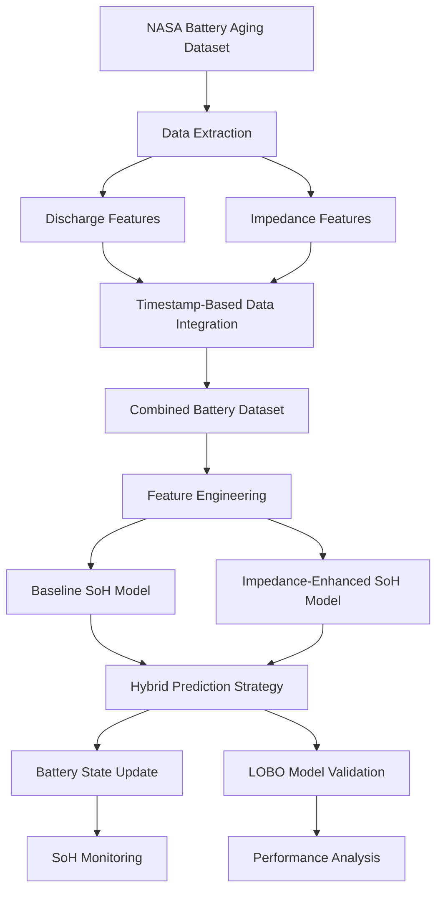

# Battery Digital Twin: Explainable State-of-Health Estimation

A data-driven Digital Twin prototype for lithium-ion battery health monitoring, combining operational measurements, electrochemical impedance indicators, and machine learning to estimate Battery State of Health (SoH).

The project investigates how measurable battery characteristics can support interpretable health estimation, how impedance information contributes to predictive performance, and how a hybrid modelling strategy can handle incomplete measurements.

---

## Project Overview

Lithium-ion batteries gradually lose their capacity and performance through ageing. Reliable State-of-Health estimation is essential for battery monitoring, predictive maintenance, and Battery Management Systems.

This project develops a data-driven Digital Twin prototype using the NASA Battery Aging dataset. It integrates discharge measurements and electrochemical impedance indicators into a unified dataset, applies machine learning models for SoH estimation, and represents battery health through an updatable digital state.

**Main research question**

To what extent can operational measurements and impedance-derived indicators improve the accuracy and interpretability of State-of-Health estimation across different lithium-ion battery cells?

### Objectives

- Extract and integrate operational and impedance measurements from battery ageing experiments.
- Investigate the relationship between battery degradation and measurable health indicators.
- Develop baseline and impedance-enhanced machine learning models for SoH estimation.
- Implement a hybrid prediction strategy to handle missing impedance measurements.
- Evaluate generalisation to previously unseen battery cells.
- Develop a digital representation of battery health that can be updated using successive observations.

---

## Dataset

The project uses the **NASA Battery Aging Dataset**, available through the NASA Prognostics Data Repository and its PHM Society mirror.

Four lithium-ion batteries are analysed:

| Battery | Discharge observations | Impedance observations |
|---|---:|---:|
| B0005 | 168 | 278 |
| B0006 | 168 | 278 |
| B0007 | 168 | 278 |
| B0018 | 132 | 53 |
| **Total** | **636** | **687** |

The dataset contains charge, discharge, and electrochemical impedance spectroscopy (EIS) measurements collected during battery ageing experiments.

### Measurement characteristics

- **Charging:** Constant-current charging at 1.5 A until 4.2 V, followed by constant-voltage charging until the current decreases to 20 mA.
- **Discharging:** Constant-current discharge at approximately 2 A, with battery-specific voltage cut-off limits.
- **Impedance:** Electrochemical impedance measurements over a frequency range of 0.1 Hz to 5 kHz.

The extracted impedance indicators include:

- \(R_e\): estimated electrolyte resistance.
- \(R_{ct}\): estimated charge-transfer resistance.

The project retains missing impedance observations rather than removing the corresponding discharge records. Timestamp-based matching with a one-hour tolerance produces an integrated dataset containing **636 discharge observations, of which 419 have matched impedance measurements**.

### Dataset source

- [NASA Battery Data Set – PHM Society mirror](https://phm-datasets.s3.amazonaws.com/NASA/5.+Battery+Data+Set.zip)
- [Dataset documentation and citation](data/README.md)

The original MATLAB files are not included in this repository.

---

## Digital Twin Architecture

The proposed architecture follows a data-driven Digital Twin workflow. It connects experimental measurements, feature extraction, data integration, health estimation, and battery-state updates.

### System workflow

1. **Data acquisition:** The NASA dataset provides charge, discharge, and impedance measurements for four lithium-ion battery cells.

2. **Feature extraction:** Discharge features include voltage, current, temperature, discharge capacity, and calculated SoH. Impedance features include \(R_e\) and \(R_{ct}\).

3. **Data integration:** Discharge and impedance observations are associated through timestamp-based matching. An impedance measurement is considered available when it falls within the one-hour matching window.

4. **Feature engineering:** Operational and impedance-derived features are prepared for model training and evaluation.

5. **Health estimation:** A baseline Ridge Regression model and an impedance-enhanced model estimate battery SoH. A hybrid prediction strategy selects the impedance-enhanced prediction when impedance data are available and otherwise uses the baseline model.

6. **Digital Twin state update:** The estimated SoH and available measurements are incorporated into a battery-state representation, enabling health monitoring across successive observations.

7. **Model validation:** Leave-One-Battery-Out (LOBO) validation evaluates the predictive performance and generalisation of the models across unseen battery cells.

### Architecture diagram

---

## Methodology

### State of Health estimation

Battery State of Health is calculated from the measured discharge capacity relative to the initial discharge capacity of the corresponding battery.

$$
SoH_i(\%) =
\frac{Q_i}{Q_{\mathrm{initial}}}\times 100
$$

Where:

- \(Q_i\) is
